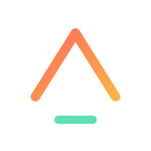
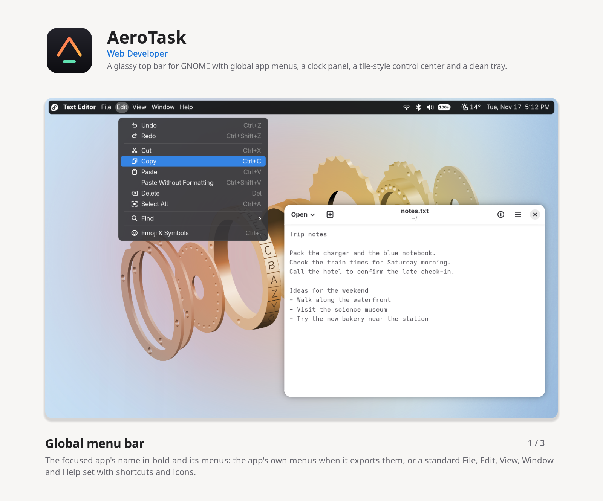
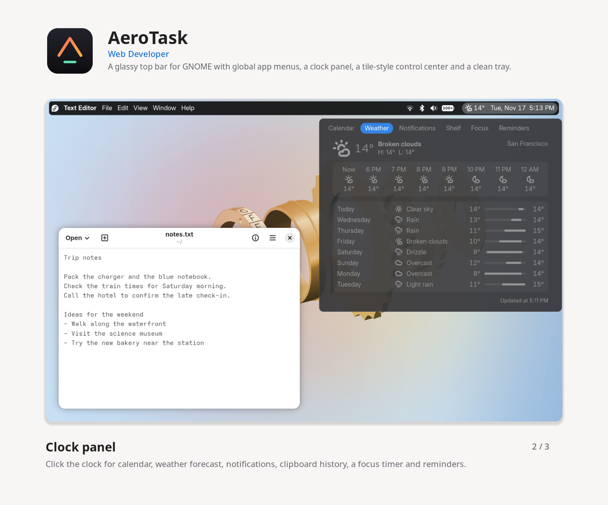
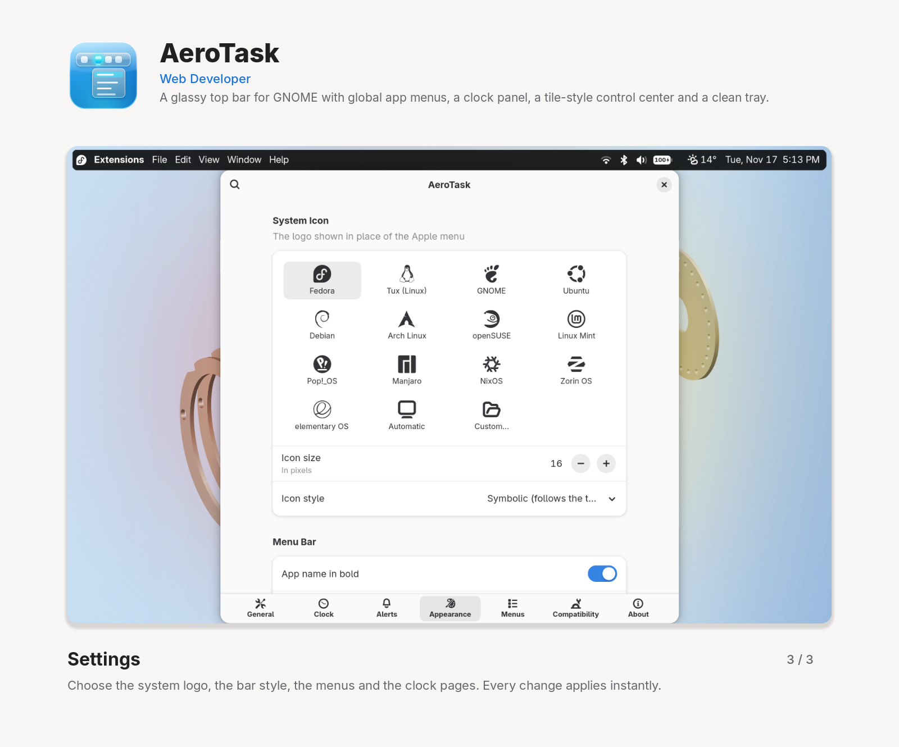

<p align="center">
  
</p>

# AeroTask — version 1.0.0

A glassy top bar for GNOME with global app menus, a clock panel, a tile-style control center and a clean tray.



## About me

Web Developer

## Description

AeroTask turns the GNOME top bar into one complete, glassy menu bar. On the left you get the AeroTask logo (or your distro's) with a system menu, the name of the focused app in bold and that app's menus: the app's own menus when it exports them, or a standard File, Edit, View, Window and Help set when it doesn't. On the right, the clock opens a panel with your calendar, the weather forecast, notifications, clipboard history, a focus timer and reminders.

## Features

- **Global menu bar**: the focused app's real menus (GTK apps natively; Qt and Electron apps running through XWayland), or standard menus whose items use the app's own actions, window controls or keyboard shortcuts. Items that can't work are shown greyed out.
- **System menu** behind the logo (AeroTask by default, or your distro's): About This Computer, settings, software center, recent items, Force Quit, suspend, restart, power off, lock and log out.
- **Search in the Help menu**: finds any menu item of the current app and runs it with Enter.
- **Clock panel**: calendar with world clocks, weather with an hourly and multi-day forecast, notifications, clipboard history (Shelf) with a file tray, focus timer and reminders.
- **Tile-style control center** built on GNOME's own Quick Settings, with a Now Playing tile and a Keep Screen On toggle.
- **Status icons with their own menus**: Wi-Fi and Bluetooth open a menu of networks or devices, a Control Center button next to the clock opens Quick Settings, and the volume icon can stay out of the bar (or switch back to GNOME's classic layout). Every icon sits at the same distance from its neighbours.
- **One on-screen HUD** in the center of the screen for volume, brightness, keyboard backlight, Caps Lock and Quick Settings toggles.
- **Clean tray**: native tray icons (AppIndicator / StatusNotifierItem), shown monochrome to match the bar, and a battery icon with the percentage inside.
- **Bar style**: keep GNOME's own look, switch to absolute black, or use Glass, a translucent bar with AeroTask's own blur of the wallpaper. An optional floating bar with rounded corners touches the screen edges while a window is maximized.
- **Settings** for the logo, icon size, menu opacity and corner radius, bar opacity, clock pages, shortcuts and alerts. Changes apply instantly.

| | |
|---|---|
|  |  |

## Compatibility

- Made for **GNOME Shell 51**, tested on Fedora 45 with GNOME 51 (Wayland).
- Real Qt and Electron menus need the app to run through XWayland; on native Wayland those apps get the standard menus.
- Works alongside Blur my Shell and Just Perfection.

## Installation

From [extensions.gnome.org](https://extensions.gnome.org), or from source:

```bash
git clone https://github.com/bispov19/aerotask.git
cd aerotask
./scripts/install.sh
```

Then log out and back in (on Wayland, GNOME loads new extensions at login) and enable it:

```bash
gnome-extensions enable aerotask@bispov19
```

Detailed documentation (in Portuguese) is in [docs/README.pt-BR.md](docs/README.pt-BR.md).

## Feedback

Found a bug or have an idea? Please [open an issue](https://github.com/bispov19/aerotask/issues) on the project page.

## License

AeroTask is free software under the [GNU GPL version 3 or later](LICENSE). Distro logos come from [Simple Icons](https://simpleicons.org); see [icons/CREDITS.md](icons/CREDITS.md). Trademarks belong to their owners.
